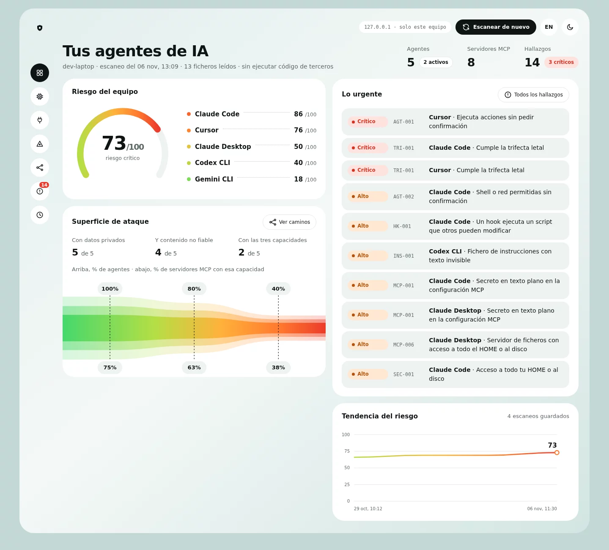
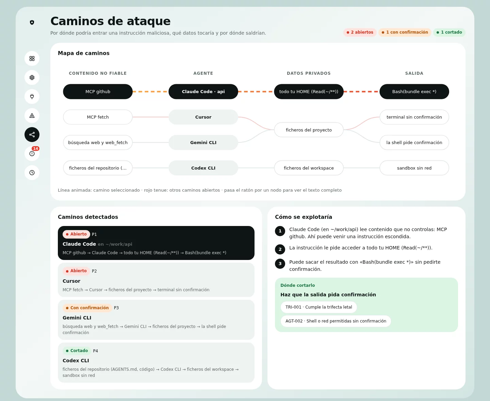
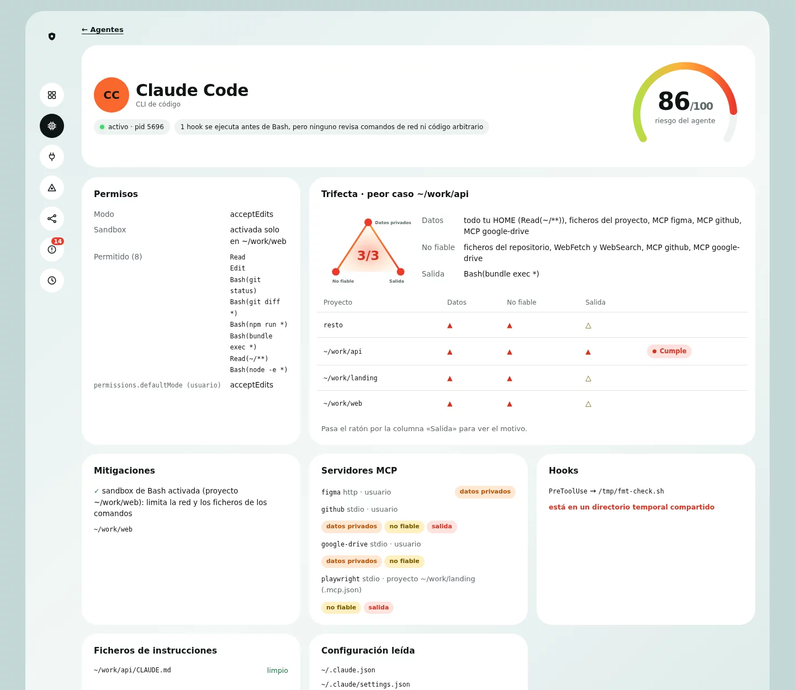
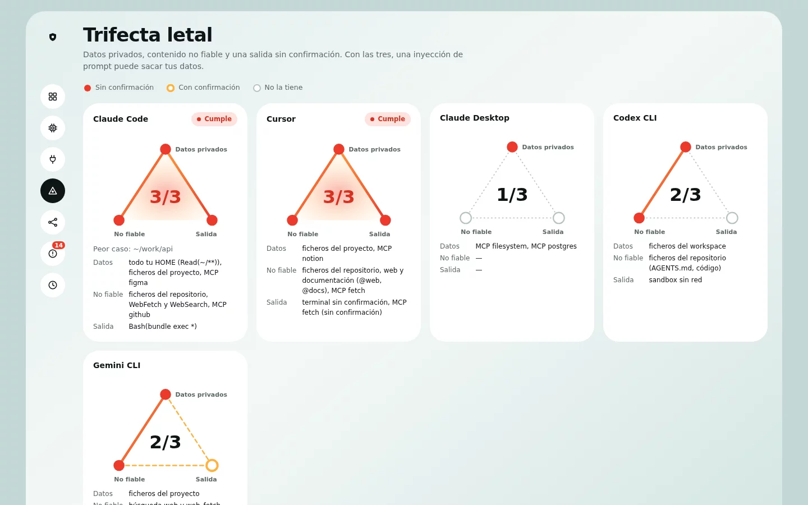
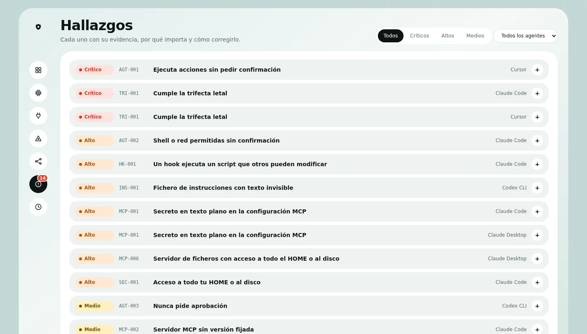
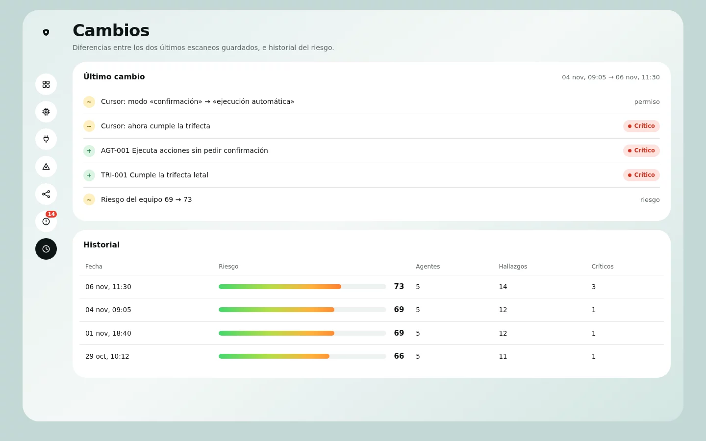
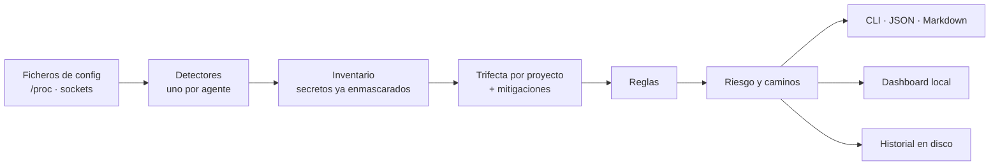

# Squadwatch

Auditor de seguridad local para los agentes de IA de tu equipo. Detecta qué
agentes tienes instalados (Claude Code, Cursor, Codex, Gemini CLI, Copilot…),
lee su configuración y te dice qué pueden hacer, qué exponen, qué riesgo
tienen y cómo corregir cada problema.




<sub>Todas las capturas usan el HOME de demostración de
[`scripts/demo-home.sh`](scripts/demo-home.sh): agentes, rutas y secretos
inventados.</sub>

## Por qué

Un portátil de desarrollo actual tiene varios agentes de IA con acceso a la
shell, a tus ficheros y a servicios externos a través de servidores MCP.
Cada uno guarda permisos, servidores, hooks y credenciales en su propio
formato y en su propia carpeta. Nadie revisa el conjunto, y los riesgos
reales aparecen al combinarlo:

- Una regla `Bash(bundle exec *)` aprobada con prisa en un proyecto deja que
  el agente ejecute cualquier cosa sin preguntar.
- Un servidor MCP de GitHub lee issues que escribe cualquiera y tiene un
  token con acceso a tus repos privados.
- Un `AGENTS.md` de un fork lleva instrucciones escondidas en caracteres
  Unicode invisibles.
- La API key de un servidor MCP está en texto plano en un fichero que leen
  otros agentes.

Squadwatch reúne todo eso en un solo informe, con la evidencia (fichero y
línea) de cada problema.

## Qué hace

- **Inventario.** Agentes instalados y en ejecución, versión, modo de
  permisos, sandbox, reglas `allow`/`ask`/`deny`, servidores MCP, hooks,
  ficheros de instrucciones y puertos abiertos.
- **Trifecta letal por proyecto.** Detecta los agentes que juntan datos
  privados, contenido no fiable y una salida sin confirmación, en qué
  proyecto ocurre y qué mitigaciones lo frenan.
- **Caminos de ataque.** Por dónde entraría una instrucción maliciosa, qué
  datos tocaría y por dónde saldrían.
- **14 reglas** con evidencia, explicación y qué hacer: modos sin
  confirmación, comodines de shell y de código, secretos en claro, servidores
  MCP sin versión fijada, hooks modificables, texto invisible, servidores de
  modelos abiertos a la red…
- **Riesgo de 0 a 100** por agente y para todo el equipo, con historial y
  comparación entre escaneos.
- **CLI, Markdown, JSON y un dashboard local** (`squadwatch serve`).

## Capturas

| Caminos de ataque | Detalle de un agente |
|---|---|
|  |  |
| **Trifecta letal** | **Hallazgos** |
|  |  |



## Instalación

Necesitas Go 1.22 o posterior.

```sh
go install github.com/sergio-lopez-dev/squadwatch/cmd/squadwatch@latest
```

O desde el código:

```sh
git clone https://github.com/sergio-lopez-dev/squadwatch
cd squadwatch
make install      # compila y copia el binario a ~/.local/bin
```

Es un único binario sin dependencias en tiempo de ejecución. El dashboard va
embebido dentro.

## Primeros pasos

```sh
squadwatch scan                 # inventario y riesgos
squadwatch show claude-code     # detalle de un agente
squadwatch findings -min high   # hallazgos altos y críticos, con evidencia
squadwatch serve                # dashboard en http://127.0.0.1:7777
```

```
$ squadwatch scan
Squadwatch 0.1.0 · escaneo estático (no se ha ejecutado código de terceros)
✓ 5 agentes · 8 servidores MCP · 13 ficheros leídos · 5 ms

 AGENTE          ESTADO               RIESGO              MCP  HALLAZGOS
 Claude Code     ■ activo · pid 4242  86      █████████░  4    1 crítico · 4 altos · 1 medio
 Cursor          instalado            76      ████████░░  2    2 críticos · 1 medio
 Claude Desktop  instalado            50      █████░░░░░  2    2 altos · 1 medio
 Codex CLI       ■ activo · pid 4310  40      ████░░░░░░  –    1 alto · 1 medio
 Gemini CLI      instalado            18      ██░░░░░░░░  –    sin hallazgos

 Riesgo del equipo 73/100 (crítico) · 3 críticos · 7 altos · 4 medios

  CRÍTICO  AGT-001  Cursor: Ejecuta acciones sin pedir confirmación
  CRÍTICO  TRI-001  Claude Code: Cumple la trifecta letal
  CRÍTICO  TRI-001  Cursor: Cumple la trifecta letal
  ALTO     AGT-002  Claude Code: Shell o red permitidas sin confirmación
  …
```

```
$ squadwatch findings TRI-001
  CRÍTICO  TRI-001  Claude Code      Cumple la trifecta letal
     En ~/work/api · datos privados: todo tu HOME (Read(~/**)), ficheros del proyecto, MCP github…
     En ~/work/api · contenido no fiable: ficheros del repositorio, WebFetch y WebSearch, MCP github…
     En ~/work/api · salida sin confirmación: Bash(bundle exec *)
     Por qué: Junta acceso a datos privados, contacto con contenido no fiable y una vía para
     sacar datos sin pedir confirmación. […]
     Qué hacer: Rompe uno de los tres lados en ~/work/api. Lo más fácil suele ser que la
     salida pida confirmación: quita de allow las reglas con comodín de ese proyecto.
```

## Comandos

| Comando | Qué hace |
|---|---|
| `squadwatch scan` | Inventario y riesgos. Guarda el escaneo en el historial. |
| `squadwatch scan --format md -o informe.md` | Informe en Markdown para compartir. |
| `squadwatch scan --format json` | El escaneo completo en JSON. |
| `squadwatch agents` | Agentes detectados, con su versión, estado y configuración. |
| `squadwatch show <agente>` | Permisos, servidores MCP, hooks, instrucciones, mitigaciones y trifecta por proyecto. |
| `squadwatch mcp` | Servidores MCP de todos los agentes: tipo, versión, credenciales y capacidades. |
| `squadwatch findings` | Hallazgos con evidencia. Filtros: `-min high`, `-agent codex`, `MCP-001`. |
| `squadwatch trifecta` | Qué agentes juntan datos privados, contenido no fiable y salida. |
| `squadwatch paths` | Caminos de ataque. |
| `squadwatch diff` | Qué ha cambiado desde el último escaneo guardado. |
| `squadwatch history` | Evolución del riesgo. |
| `squadwatch serve` | Dashboard en http://127.0.0.1:7777 (`-addr` para cambiar el puerto). |
| `squadwatch rules` | Reglas que comprueba. |

Opciones comunes:

- `-json` en casi todos los comandos.
- `-home <dir>` para auditar otro directorio home.
- `--fail-on high` en `scan` y `findings`: sale con código 1 si hay
  hallazgos de esa severidad o peor. Útil en scripts.
- `--no-save` en `scan` para no guardarlo en el historial.

## La trifecta letal

Un agente es crítico cuando junta tres cosas:

1. **Acceso a datos privados**: tus ficheros, tus repos, tu Drive, tu base de
   datos.
2. **Contacto con contenido no fiable**: webs, issues, ficheros de repos
   ajenos, documentos compartidos.
3. **Una forma de enviar datos fuera sin pedir confirmación**: una shell con
   comodín, un servidor MCP que publica o navega sin preguntar.

Con las tres, una instrucción escondida en una web o en un issue puede hacer
que el agente lea tus datos y los envíe a otro sitio, sin que lo veas. El
concepto lo describió [Simon Willison](https://simonwillison.net/2025/Jun/16/the-lethal-trifecta/).

Cómo lo calcula Squadwatch:

- **Suma lo que el agente hace por sí mismo y lo que le añaden sus servidores
  MCP.** El catálogo de servidores conocidos indica qué aporta cada uno; los
  que no están en el catálogo aparecen como «capacidades desconocidas».
- **Solo cuenta como salida lo que no pide confirmación.** Una salida que
  pregunta antes cuenta como parcial (△), no como completa.
- **Una regla con un comando exacto no es una salida.**
  `Bash(curl -s https://example.com/)` solo permite ese comando literal. Sí
  cuentan los comodines de red (`Bash(curl *)`, `WebFetch` sin dominio) y los
  que dejan elegir el código que se ejecuta: `Bash(node -e *)`,
  `Bash(bundle exec *)`, `Bash(npx *)`, `Bash(sudo *)`…
- **Por proyecto.** En Claude Code, los permisos y servidores MCP de un
  proyecto solo valen dentro de ese proyecto. La trifecta se calcula en cada
  uno y el informe dice dónde se cumple.
- **Con mitigaciones.** Antes de dar una salida por abierta busca qué la
  frena: hooks `PreToolUse` sobre Bash que revisan comandos de red y pueden
  bloquearlos (lee el script del hook), la sandbox de Bash activada y reglas
  `deny` sobre `~/.ssh`. Si tienes hooks pero ninguno revisa la red, también
  te lo dice.

## Reglas

| ID | Severidad | Qué comprueba |
|---|---|---|
| TRI-001 | Crítica | Datos privados + contenido no fiable + salida sin confirmación, en algún proyecto |
| AGT-001 | Crítica | Modos sin confirmación: `bypassPermissions`, yolo, auto-run, `approval_policy = "never"` sin sandbox |
| AGT-002 | Alta | Shell, red o intérpretes con comodín permitidos sin preguntar |
| AGT-003 | Media | Codex sin aprobaciones dentro de la sandbox |
| AGT-004 | Alta | Codex sin sandbox (`danger-full-access`) |
| SEC-001 | Alta | Lectura sin preguntar de todo el HOME o del disco (media si hay `deny` sobre `~/.ssh`) |
| MCP-001 | Alta | Credenciales en texto plano: variables de entorno, cabeceras, argumentos, contraseñas en URLs |
| MCP-002 | Media | Servidores MCP sin versión fijada: `npx paquete`, `@latest`, `uvx` sin `==`, imágenes sin digest |
| MCP-003 | Alta | Servidores MCP remotos por `http://` |
| MCP-006 | Alta | Servidor de ficheros con raíz en `/` o en el HOME |
| MCP-007 | Media | `enableAllProjectMcpServers`: aprueba el `.mcp.json` de cualquier repo clonado |
| HK-001 | Alta | Hooks que ejecutan scripts de `/tmp` o modificables por otros usuarios |
| INS-001 | Alta | Texto invisible en `CLAUDE.md`, `AGENTS.md`, `GEMINI.md`, skills y subagentes (etiquetas Unicode, bidi, ancho cero); el texto oculto se decodifica |
| NET-001 | Alta | Ollama o LM Studio escuchando en una dirección accesible desde la red |

Cada hallazgo lleva referencias al
[OWASP Top 10 para aplicaciones LLM](https://genai.owasp.org/llm-top-10/).

## Agentes soportados

| Agente | Qué lee |
|---|---|
| Claude Code | `~/.claude/settings*.json`, `~/.claude.json` (servidores MCP de usuario y de cada proyecto), `.claude/settings*.json` y `.mcp.json` de cada proyecto, `/etc/claude-code/managed-settings.json`, `CLAUDE.md`, skills, subagentes y plugins |
| Cursor | `~/.cursor/mcp.json`, `~/.config/Cursor/User/settings.json` |
| Codex CLI | `~/.codex/config.toml` (incluidos perfiles y servidores MCP), `AGENTS.md` de los proyectos de confianza |
| Gemini CLI | `~/.gemini/settings.json`, `~/.gemini/GEMINI.md` |
| VS Code + Copilot | extensión `github.copilot-chat`, `settings.json` y `mcp.json` de usuario |
| Windsurf | `~/.codeium/windsurf/mcp_config.json` |
| Claude Desktop | `claude_desktop_config.json` |
| Aider | `~/.aider.conf.yml` |
| Ollama | binario, `~/.ollama`, puerto 11434 y overrides de systemd |
| LM Studio | `~/.lmstudio`, puerto 1234 |

En todos detecta además si están en ejecución, leyendo `/proc` (Linux) o
`ps` (macOS).

## Cómo funciona



1. **Detectores.** Uno por agente. Solo leen ficheros, `/proc` y los sockets
   en escucha; nunca arrancan un agente ni un servidor MCP. Entienden JSON
   con comentarios (VS Code, Cursor), TOML (Codex) y YAML simple (Aider).
2. **Inventario.** Un modelo común para todos los agentes. Los secretos se
   enmascaran aquí, antes de que nada pueda imprimirlos o guardarlos.
3. **Trifecta.** Capacidades del agente más las de sus servidores MCP, por
   proyecto, descontando lo que esté mitigado.
4. **Reglas.** Cada una produce hallazgos con evidencia (fichero y línea),
   explicación, qué hacer y referencias.
5. **Riesgo y caminos de ataque**, y después las salidas.

## Seguridad y privacidad

Una herramienta que lee las configuraciones de tus agentes tiene que ser más
estricta que ellos:

- **Solo lectura.** No modifica ningún fichero ni ejecuta código de terceros.
- **Sin red.** No hace ninguna conexión saliente. El dashboard no carga
  fuentes, scripts ni imágenes de internet.
- **Secretos siempre enmascarados** (`••••a1B2`) en la terminal, el JSON, el
  Markdown, el historial y el dashboard. Hay un test que comprueba que ningún
  secreto sale en claro.
- **Dashboard solo en localhost.** Se niega a escuchar en una dirección que no
  sea de loopback, rechaza peticiones con otro `Host` (protección frente a DNS
  rebinding), envía una `Content-Security-Policy` estricta y escapa todo el
  texto que viene de las configuraciones.
- **Historial privado.** Los escaneos se guardan en
  `~/.local/share/squadwatch/scans/` con permisos `0600`; se conservan los
  100 últimos.
- **Una sola dependencia** ([BurntSushi/toml](https://github.com/BurntSushi/toml),
  para la configuración de Codex). El resto es la librería estándar de Go.

## Puntuación

- **Puntos de un agente:** 30 por hallazgo crítico, 15 por alto, 6 por medio,
  2 por bajo, más 2 por cada evidencia adicional (hasta 3). Se suman 5 por
  cada lado de la trifecta que tiene sin confirmación y 2 si lo tiene con
  confirmación.
- **Riesgo de un agente (0–100):** `100 × (1 − e^(−puntos/60))`. La curva no
  llega a 100, así que arreglar cualquier problema baja el número, incluso en
  un agente muy expuesto. Un agente con un hallazgo crítico nunca baja de 70.
- **Riesgo del equipo:** 60 % el agente con más riesgo y 40 % la media de los
  demás.

## Probarlo sin tocar tu equipo

[`scripts/demo-home.sh`](scripts/demo-home.sh) crea un HOME ficticio con
configuraciones arriesgadas para cinco agentes. Es lo que se usa para las
capturas.

```sh
scripts/demo-home.sh /tmp/sw-demo
PATH=/usr/bin:/bin SQUADWATCH_HOST=dev-laptop XDG_DATA_HOME=/tmp/sw-data \
  squadwatch serve -home /tmp/sw-demo
```

- `PATH` limitado evita que encuentre los binarios reales de tus agentes.
- `XDG_DATA_HOME` separa el historial de la demo del tuyo.
- `SQUADWATCH_HOST` cambia el nombre del equipo que aparece en el informe.

## Desarrollo

```sh
make test     # tests: detectores, reglas, trifecta por proyecto, mitigaciones, que ningún secreto se filtre…
make vet      # go vet + gofmt
make build    # bin/squadwatch
```

```
cmd/squadwatch/       CLI
internal/detect/      un detector por agente
internal/mcpcat/      catálogo de capacidades de servidores MCP
internal/rules/       reglas y textos de los hallazgos
internal/risk/        trifecta por proyecto, mitigaciones, caminos de ataque y puntuación
internal/redact/      enmascarado de secretos
internal/store/       historial de escaneos
internal/diff/        comparación entre escaneos
internal/report/      salida de terminal y Markdown
internal/server/      dashboard local (HTML embebido en el binario)
scripts/              HOME de demostración
```

Para añadir un agente: un detector en `internal/detect/` que rellene
`model.Agent` (configuración, permisos, servidores MCP y capacidades base) y
un test con un HOME falso en `internal/scan/scan_test.go`.

## Limitaciones

- **Plataforma.** Linux es la plataforma principal. En macOS funcionan los
  detectores, pero aún no se leen los puertos en escucha. Windows no está
  probado.
- **Cursor** guarda parte de sus ajustes en una base de datos interna que
  todavía no se lee.
- **Capacidades de los servidores MCP.** Se deducen de su nombre y su
  paquete; los que no están en el catálogo aparecen como desconocidos.
- **Sin sondeo en vivo.** No arranca los servidores MCP, así que aún no
  detecta cambios en las descripciones de sus herramientas (*rug pulls* o
  *tool poisoning*).
- **Mitigaciones heurísticas.** Un hook cuenta como mitigación si su script
  menciona comandos de red y tiene forma de bloquear. No ejecuta el hook
  para comprobarlo.

## Hoja de ruta

- `squadwatch watch`: vigilancia continua con avisos cuando cambia una
  configuración.
- `squadwatch policy apply`: una sola política para todos los agentes,
  traducida al formato de cada uno.
- Sondeo de servidores MCP dentro de una sandbox para detectar *tool
  poisoning*.
- Honeytokens: credenciales trampa que avisan si un agente las lee.
- Lectura de las sesiones de los agentes para saber qué ejecutaron.
- Auditoría de las configuraciones de un repositorio en CI, con salida SARIF.
